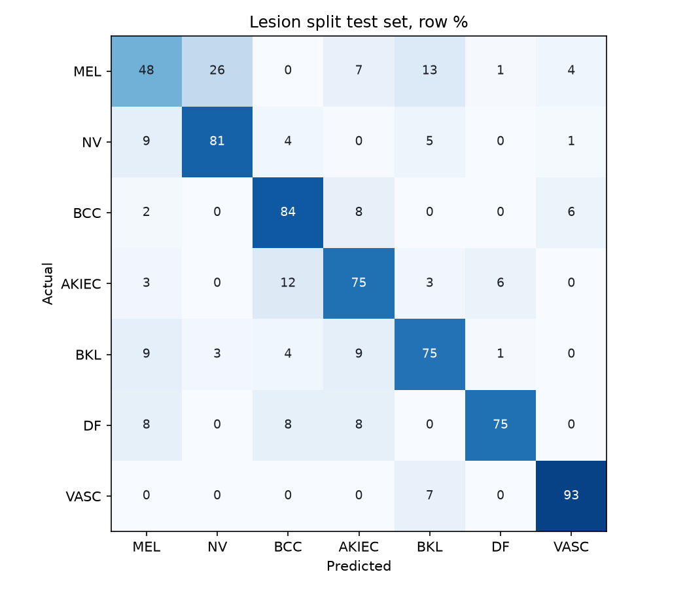
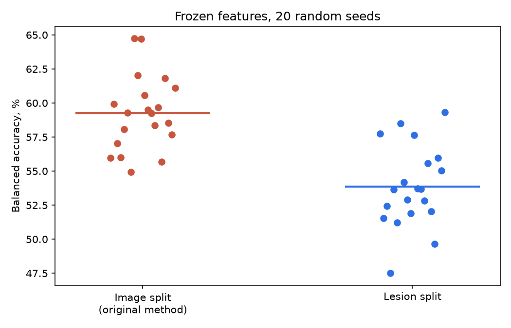
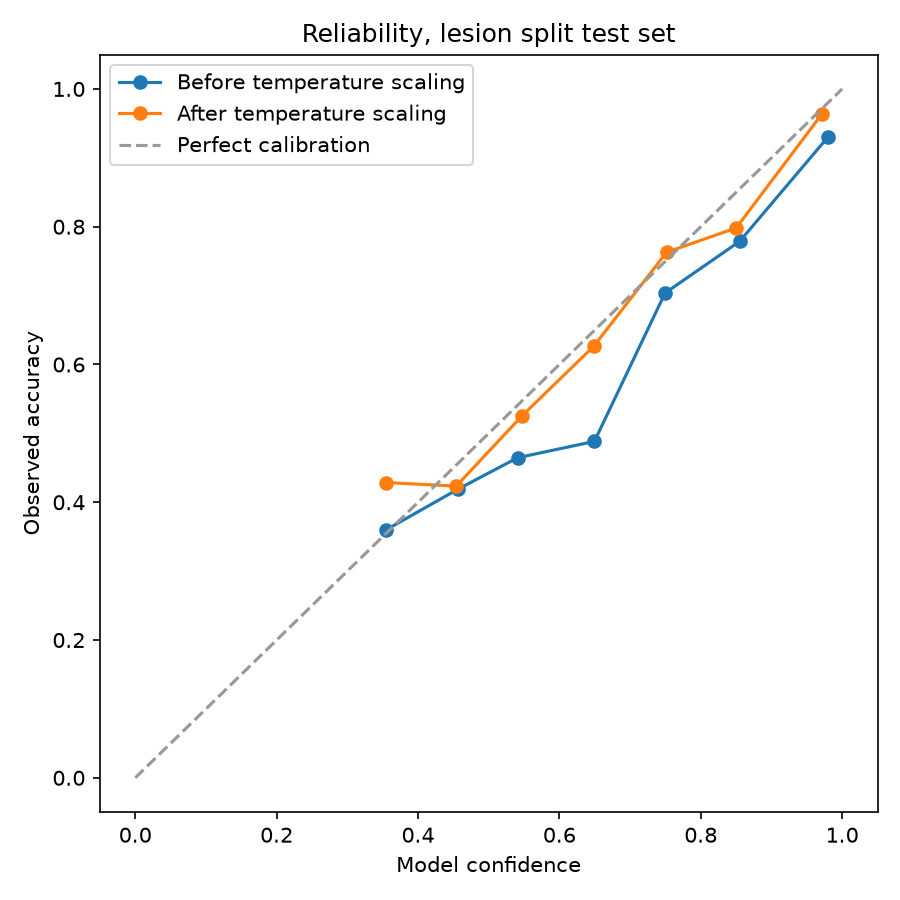

# Skin Lesion Classification on HAM10000, Evaluated by Lesion

EfficientNetB0 fine tuned to sort dermoscopy images into seven diagnoses, with an evaluation that keeps every photo of a lesion on one side of the train and test boundary.

This is version 2 of the project. Version 1 reported 74.15% test accuracy from a random split over images. HAM10000 often holds several photos of the same lesion, so that split let the model see one photo of a lesion in training and be tested on another photo of the same lesion. Version 2 measures how much that mattered and reports the model on lesions it has never seen.

> Research prototype for learning and portfolio use. It is not a diagnostic tool and has not been validated on any clinical population.

## What changed and why

| | Version 1 | Version 2 |
|---|---|---|
| Split | Random over 10,015 images | Grouped by `lesion_id` over 7,470 lesions, stratified by diagnosis |
| Test photos whose lesion also appears in training | 398 of 1,002 (seed 42) | 0 |
| Headline metric | Accuracy | Balanced accuracy, melanoma AUROC and a melanoma triage operating point |
| Best epoch chosen by | Validation accuracy | Validation balanced accuracy |
| Uncertainty | None | 95% bootstrap intervals that resample whole lesions |
| Calibration | Not checked | Temperature scaling fitted on validation |
| Runs | One notebook run on a Colab GPU | Six runs (two splits, three seeds) plus a 20 seed frozen feature check, all on GitHub Actions |
| Code | One notebook | `skinclf` package, unit tests, CI |

The training recipe itself is unchanged: ImageNet EfficientNetB0, last three blocks unfrozen, the same classifier head, class weighted cross entropy, AdamW at 1e-3, cosine schedule, flips, rotation and colour jitter, 10 epochs at 224 by 224.

## Why the split matters here

HAM10000 has 10,015 images of 7,470 lesions. 1,956 lesions have between two and six photos. The repeats are not spread evenly: 79% of melanoma photos belong to a lesion with more than one photo, against 34% of melanocytic nevi. So a random image split leaks most heavily in exactly the class that matters most.

## Results

All numbers below come from [`results/RESULTS.md`](results/RESULTS.md) and [`results/summary.json`](results/summary.json), which the workflow writes from the saved predictions.

### Same recipe, two splits, three seeds

| Metric | Image split (version 1 method), per seed | Lesion split, per seed | Image split higher on |
|---|---|---|---|
| Accuracy | 79.1, 78.5, 73.6 | 72.5, 74.6, 76.5 | 2 of 3 seeds |
| Balanced accuracy | 73.5, 78.3, 76.9 | 72.7, 76.9, 75.8 | 3 of 3 seeds |
| Melanoma AUROC | 0.914, 0.922, 0.900 | 0.861, 0.899, 0.879 | 3 of 3 seeds |
| Malignant vs benign AUROC | 0.939, 0.928, 0.922 | 0.897, 0.922, 0.897 | 3 of 3 seeds |

Seeds 1, 2 and 42. The image split scored higher on melanoma AUROC every time, by 0.032 on average, and on balanced accuracy every time, by 1.1 points on average. Accuracy moved both ways.

### Frozen feature check across 20 seeds

Fine tuning six models is the most the CPU budget allowed, so a cheaper experiment repeats the comparison many times: frozen ImageNet EfficientNetB0 embeddings with a class weighted logistic regression.

| | Image split | Lesion split |
|---|---|---|
| Balanced accuracy, mean (min to max) | 59.2% (54.9% to 64.8%) | 53.8% (47.5% to 59.3%) |
| Test photos whose nearest training photo is the same lesion | 16.3% | 0.0% |

The image split scored higher on 18 of 20 seeds, by 5.4 points on average.

### The lesion split model (seed 42)

| Metric | Value (95% interval) |
|---|---|
| Accuracy | 76.5% (73.5 to 79.9) |
| Balanced accuracy | 75.8% (70.8 to 81.1) |
| Melanoma AUROC | 0.879 (0.833 to 0.917) |
| Melanoma recall at the most likely class | 48.2% (36.8 to 61.2) |

Picking the most likely class misses about half of melanomas, and across seeds that recall swung between 48.2% and 81.1%. A screening use needs a fixed threshold instead, so the report sets one on validation to catch 90% of melanomas and applies it unchanged to test:

| Melanoma triage | Value (95% interval) |
|---|---|
| Sensitivity | 91.1% (82.5 to 97.7) |
| Specificity | 66.3% (62.7 to 70.0) |

Temperature scaling (T = 1.33) cut expected calibration error from 6.5% to 3.3% on test.





## What this shows, and what it does not

The leak was real: about four in ten test photos in version 1 showed a lesion the model had trained on. For this fine tuned model its effect on overall accuracy was small and inside the noise between seeds, so the version 1 accuracy was not badly inflated. Its effect on melanoma ranking was consistent across seeds, which fits the fact that melanoma photos are the most often repeated.

Limits worth stating plainly:

- Three fine tuning seeds is a small sample, and each seed also draws a different test set.
- Triage sensitivity and specificity trade off, so compare them together; AUROC is the threshold free comparison.
- Everything is evaluated inside HAM10000. Nothing here says how the model would do on images from other clinics, cameras or skin types.

## Reproduce

```bash
pip install torch torchvision --index-url https://download.pytorch.org/whl/cpu
pip install -e ".[dev]"
pytest -q

python -m skinclf.data data                                  # download HAM10000 from Harvard Dataverse, build the image cache
python -m skinclf.train --split lesion --seed 42 --out runs/lesion-s42
python -m skinclf.train --split image  --seed 42 --out runs/image-s42
python -m skinclf.leakage --out runs/leakage --seeds 20
python -m skinclf.report --runs runs --out results
```

The `train and evaluate` workflow runs all of this on GitHub Actions and commits the results. The trained lesion split model is saved at `models/lesion_split_efficientnet_b0.pth`.

## Layout

```
src/skinclf/
  data.py      download from Harvard Dataverse, metadata checks, image cache
  splits.py    image split (version 1) and lesion split
  model.py     EfficientNetB0 with the version 1 head
  train.py     fine tuning, saves validation and test logits
  leakage.py   frozen feature comparison across seeds
  metrics.py   balanced accuracy, AUROC, calibration, lesion level bootstrap
  report.py    results/summary.json, results/RESULTS.md and figures
tests/         split, metric, data and model tests
skin_disease_classifier.ipynb   the original version 1 notebook
```

## Data

Tschandl, P., Rosendahl, C. and Kittler, H. The HAM10000 dataset, a large collection of multi-source dermatoscopic images of common pigmented skin lesions. Scientific Data 5, 180161 (2018). Downloaded from Harvard Dataverse, doi:10.7910/DVN/DBW86T, under CC BY-NC 4.0.

## Live demo

https://huggingface.co/spaces/samurvivor-07/skin-disease-classifier

The Space runs `app.py` from this repository, pinned to a commit. It serves the version 2 lesion split model, applies the validation temperature (1.33) to its probabilities, and flags an image for melanoma review when the melanoma probability reaches the threshold set on validation (9.5%). For education only, not a diagnostic tool.
